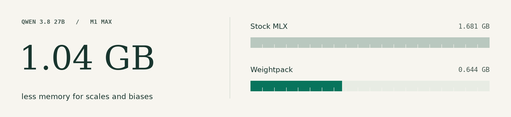

# Weightpack for MLX

Weightpack gives each distinct scale and bias pair in a quantized matrix a short index. The four-bit weights stay in the original checkpoint. On a Qwen 3.8 27B model, this freed **1.04 GB** of MLX memory held by metadata. Every one of the 420 million pairs came back bit for bit.



## Try it

The demo makes a tiny checkpoint, packs it, then compares every reconstructed pair with the original. It runs offline on Python 3.10 or later.

```sh
git clone https://github.com/Davcca/mlx-weightpack.git
cd mlx-weightpack
uv run weightpack demo
```

<details>
<summary>Install with Python and pip</summary>

Run these commands from the cloned repository on macOS or Linux.

```sh
python3 -m venv .venv
source .venv/bin/activate
python -m pip install .
weightpack demo
```

</details>

## Use your own checkpoint

Point `MODEL` at a local MLX model directory. Scan first to see how much space its metadata can save.

```sh
MODEL="/path/to/your/mlx-model"
uv run weightpack scan "$MODEL"
uv run weightpack pack "$MODEL" -o model.wpack
uv run weightpack verify "$MODEL" model.wpack
```

The `.wpack` file contains the tables and indices. Keep the original checkpoint beside it or elsewhere on disk. Packing needs room for the extra file, about 640 MB for the 27B model below. A model uses the compact representation when you load it through Weightpack.

For a smaller download, the generation example uses a Qwen checkpoint with 278 MB of weights. [Try Qwen2.5 0.5B](benchmarks/README.md#end-to-end-generation-on-qwen25-05b)

On an Apple Silicon Mac, generate a reply with the Metal extra. This command runs the MLX-LM text decoder. MTPLX's speculative server uses its own loader. Omit `--pack model.wpack` to run stock MLX-LM on the same prompt.

```sh
uv run --extra metal weightpack generate "$MODEL" --pack model.wpack \
  --prompt "Write a Python function that squares a number." --max-tokens 64
```

For pip, install `python -m pip install '.[metal]'`. In Python, `from weightpack.inference import load` gives you `model, tokenizer = load(model_dir, sidecar)` for use with MLX-LM.

## What it costs to run

This run scored the same continuation after a 162-token prefix on a 32 GB M1 Max using the DavidAU Qwen 27B checkpoint. Each row sums the median time for each of 64 layers and the output head. Short blocks paid for unpacking. At 8 and 16 tokens the packed Metal tiles saved time.

| Tokens scored together | Stock MLX | Weightpack | Change in time |
| ---: | ---: | ---: | ---: |
| 1 | 105.4 ms | 127.0 ms | 20.5% longer |
| 4 | 201.6 ms | 215.8 ms | 7.0% longer |
| 8 | 370.8 ms | 285.2 ms | 23.1% shorter |
| 16 | 400.3 ms | 356.9 ms | 10.8% shorter |

All **7,201,280** vocabulary scores matched bit for bit, as did the layer outputs and updated caches. The memory figure measures live allocations for the metadata alone. Whole-process peak RAM and 27B generation tokens per second remain unmeasured. A separate end-to-end run on Qwen2.5 0.5B produced the same 32 greedy token IDs with stock MLX-LM and Weightpack. [Benchmarks, raw data and reproduction commands](benchmarks/README.md)

## Under the hood

The packer works one matrix at a time. It keeps matrices in their original form when packing would make them larger. During inference, selected Metal kernels read the index directly as they multiply. Other projections reconstruct one matrix's metadata for MLX. [File format and kernel selection](docs/format.md)

The single-row kernel uses the dot product from MTPLX by Youssof Altoukhi. [MTPLX](https://github.com/youssofal/MTPLX) · [Third-party notices](THIRD_PARTY.md)
