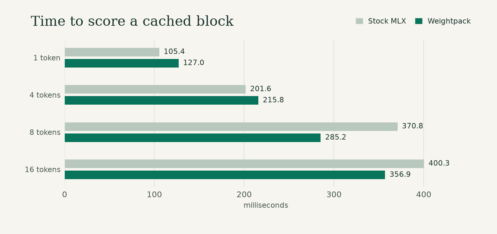

# Benchmarks

These measurements use a 32-core M1 Max with 32 GB of unified memory, macOS 27.2.1, Python 3.12.10, MLX 0.32.2 and MLX-LM 0.31.3. The 27B checkpoint is the FP16, 4-bit MLX conversion by r3lax of DavidAU's Qwen 3.8 27B. It has 64 decoder layers and uses groups of 64 weights. [Pinned checkpoint](https://huggingface.co/r3lax/DavidAU-Qwen3.8-27B-TURBO-735-882-MTPLX-4bit-FP16/tree/773aee9b52f840f7337c77a2815ba764684a3bce) · [Measured Weightpack revision](https://github.com/Davcca/mlx-weightpack/tree/4ce64ecf17bdbccf055c0aa61770ae8b10c25f64)

## Memory

| Measurement | Stock MLX | Weightpack |
| --- | ---: | ---: |
| Bytes in the 498 matrices' metadata | 1,680,834,560 | 639,417,544 |
| Active MLX bytes for those arrays | 1,680,834,560 | 644,248,700 |
| Text tensor payload with that representation | 15,132,802,048 | 14,091,385,032 |

The second row measures `mlx.core.get_active_memory()` above startup in two fresh processes. Each process keeps all 996 metadata arrays alive. MLX allocation rounding explains the difference between the first two rows. The third row is byte arithmetic over the three text shards. Replacing their metadata saves 6.9% of the text tensor payload. Vision weights, the MTP head, inference caches and working buffers are outside this measurement. All GB figures use decimal units. [Stock allocations](results/resident_stock.json) · [Packed allocations](results/resident_packed.json) · [Archive and verification](results/archive.json)

## Cached blocks



The input is a dictionary edit with 162 prefix tokens. Stock and packed operators start each measured block from a copy of the same prefilled state. Each stage gets two warm-up pairs and eight timed pairs. A seeded shuffle sets which operator goes first in each pair. The timer includes the forward pass and a device synchronization for the layer output and updated cache arrays. The final stage includes normalization and the vocabulary projection.

The reported times sum each stage's median. The harness keeps one layer at a time in memory so both operators can run on the same Mac. It excludes checkpoint I/O, prefix prefill, cache cloning, conversion, draft generation, sampling and HTTP. It checks every layer output and cache, then compares all logits. The data file includes all eight measurements per operator, stage and block width, along with a SHA-256 digest of the logits at each width. End-to-end generation latency and peak process memory on this 27B model are open measurements. [Stage timings and hashes](results/cached_blocks.json) · [Frozen input IDs](fixtures/edit_tokens.json)

Across two runs per width, one token took 7.5% to 20.5% longer and four took 6.2% to 7.0% longer. Eight tokens took 23.1% to 24.0% less time and sixteen took 10.8% to 14.8% less. Both runs used the same inputs and produced the same logits hashes. [Independent repeats](results/repeats.json)

## Reproduce the 27B run

Run from the repository root on an Apple Silicon Mac. If the checkpoint is already on disk, set `MODEL` to its directory and skip the download. The layer benchmark only needs the three numbered text shards and the configuration. It reads its input IDs from the committed fixture.

```sh
MODEL="$PWD/qwen-27b"
uvx --from huggingface-hub hf download \
  r3lax/DavidAU-Qwen3.8-27B-TURBO-735-882-MTPLX-4bit-FP16 \
  --revision 773aee9b52f840f7337c77a2815ba764684a3bce \
  --include 'model-*-of-*.safetensors' --include 'config.json' --local-dir "$MODEL"

uv run weightpack pack "$MODEL" -o qwen.wpack
uv run weightpack verify "$MODEL" qwen.wpack
uv run --extra metal python benchmarks/residency.py "$MODEL" qwen.wpack stock
uv run --extra metal python benchmarks/residency.py "$MODEL" qwen.wpack packed
uv run --extra metal python benchmarks/cached_blocks.py "$MODEL" qwen.wpack \
  --widths 1 4 8 16 --repeats 8 --output cached-run.json
```

For a shorter run, time one gate projection from the same checkpoint. The command checks output bits at every width and prints median device-synchronized times.

```sh
uv run --extra metal weightpack bench "$MODEL" qwen.wpack --rows 1 4 8 16
```

## End-to-end generation on Qwen2.5 0.5B

On this smaller checkpoint, 168 of 169 matrices became smaller. Stock MLX-LM and Weightpack generated the same 32 tokens on the prompt `Write a Python function that squares a number.` The harness loads one model at a time and checks the token IDs before rendering text. [Pinned checkpoint](https://huggingface.co/mlx-community/Qwen2.5-0.5B-Instruct-4bit/tree/a5339a4131f135d0fdc6a5c8b5bbed2753bbe0f3) · [Token IDs and pack sizes](results/qwen_05b.json)

```sh
SMALL="$PWD/qwen-05b"
uvx --from huggingface-hub hf download mlx-community/Qwen2.5-0.5B-Instruct-4bit \
  --revision a5339a4131f135d0fdc6a5c8b5bbed2753bbe0f3 --local-dir "$SMALL"
uv run weightpack pack "$SMALL" -o small.wpack
uv run --extra metal python benchmarks/greedy.py "$SMALL" small.wpack
```

To redraw both figures from the saved JSON, run `uv run --with matplotlib python benchmarks/plot.py`. The single-row dot product is from MTPLX by Youssof Altoukhi. [MTPLX](https://github.com/youssofal/MTPLX)
